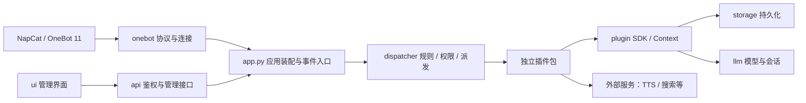

# FLLBot 项目架构

此文档描述 **FLLBot 机器人后端**。入口是 `python -m fllbot`，不包含 QQBot 桌面宿主的业务实现。



## 顶层目录

| 路径 | 职责 | 开发约定 |
| --- | --- | --- |
| `fllbot/` | 可安装、可打包的宿主源码 | 核心模块不导入用户插件的具体实现 |
| `plugins/<name>/` | 用户插件包 | 一文件夹一插件，包头、代码、用户和开发文档都在包内 |
| `fllbot/builtin_plugins/<name>/` | 随发行版提供的插件包 | 与用户插件共用清单与生命周期规范 |
| `services/` | 有独立依赖环境的外部服务 | 模型、独立虚拟环境与服务进程不混入插件目录 |
| `personas/` | 用户维护的提示词与人设 | 与宿主默认 personas 分开 |
| `tests/` | 离线回归测试与合成数据 | 用模拟连接、HTTP transport 与临时数据库隔离真实 QQ 和服务 |
| `scripts/` | 项目验证和架构工具 | 不放运行时业务实现 |
| `tools/` | 开发辅助与探测工具 | 与机器人运行入口分离 |
| `docs/` | 架构、协议、部署和开发规范 | 接口调整时同步维护 |
| `data/`、`logs/` | 数据库、令牌、插件文件与日志 | 本机生成，不提交、不写回插件源码 |

## 核心职责

`tracing.py` 是只依赖标准库的跨层诊断基础设施，提供任务上下文、元数据阶段记录和有界异步写入队列；不导入应用、协议、存储或插件实现。协议、LLM、插件 SDK 和日志只调用其元数据记录能力；app 装配记录器，storage 负责迁移与查询。新增的依赖方向由架构检查明确允许，诊断写入失败不得改变消息处理结果。

| 模块 | 职责 |
| --- | --- |
| `cli.py` / `__main__.py` | 启动、初始化、配置检查与插件包开发命令 |
| `app.py` | 组装共享服务、统一生命周期、接收并交付事件；不放具体用户命令 |
| `config.py` | 默认配置、TOML、环境变量与校验 |
| `onebot/` | 消息模型、消息段、连接与协议交互，不反向调用插件或管理 API |
| `dispatcher.py` / `rules.py` | 处理器派发、规则、并发、超时与冷却 |
| `permission.py` / `policy.py` | 开关、用户和群权限、策略解析；插件复用而非重复实现 |
| `storage/` | SQLite 与迁移、消息和配置持久化，不导入 UI、插件或应用入口 |
| `events.py` / `logging_setup.py` | 事件分发、去重、日志与观测 |
| `llm/` | 模型客户端、会话、人设、输出与转发消息适配；不依赖具体插件或 API 页面 |
| `api/` | 鉴权、参数校验、管理与控制台接口，调用已装配的宿主能力 |
| `ui/` / `webui.py` | 界面静态资源与页面交付，不承担插件业务执行 |

## 插件框架内部

```text
fllbot/plugin/
  __init__.py       稳定公开 SDK 导出
  base.py           Plugin、处理器、周期任务、AI 工具、资源清理
  context.py        当前事件上下文、回复、配置、数据与宿主能力
  settings.py       声明式字段、全局/群覆盖、持久化与密钥掩码
  manifest.py       plugin.toml 包头与目录契约，不执行源码
  imports.py        隔离命名、源码导入、子模块缓存与导入回滚
  loader.py         扫描、注册、重载事务、周期任务与运行态管理
  scaffold.py       插件包生成与离线语法检查
  templates/        随安装包分发的模板源文件
```

宿主负责共性的配置、权限、生命周期和持久化；插件负责声明自己的命令、处理器、配置和工具。
`plugin/packages.py` 管理完整第三方包的离线安装、升级、恢复和移除；`package_lock.py` 在宿主运行期间阻止包替换。
`manifest.py` 仅额外读取宿主公开的 `__version__` 常量校验版本，不依赖应用装配。
具体插件业务和资源归各自包所有；公共渲染器由宿主图片回复与 text 插件共用，不归属某个插件。
新增插件不需要修改 app.py、API 路由或宿主配置模型。插件之间通过已公开能力协作，不互相导入文件。

## 依赖边界

协议、存储、基础配置、事件与规则层不反向依赖应用装配或插件实现。
plugin SDK 可使用 rules 与 onebot；通过 Context 和类型约定访问装配后的宿主，不运行时导入 app.py。
llm 使用配置、协议模型和策略解析，不导入插件包、管理 API 或页面。
app、dispatcher 与 api 负责连接这些能力，用户插件不导入 app 或 api 的内部实现。

`scripts/check_architecture.py` 静态检查这些运行时导入方向，跳过仅供类型标注的 TYPE_CHECKING 引用；
新的跨层依赖应先明确用途并更新架构说明，而不是随意放开边界。检查覆盖显式 Python import，不替代代码审查。

## 新功能放置规则

- 命令、事件和 AI 工具：新建独立插件包，复杂模块仍留在包内。
- 配置字段：插件内 settings.py / plugin.setting；确属宿主通用能力才扩展 config.py。
- 协议消息或 QQ 动作：onebot 与 Context，补协议模拟测试。
- 数据表与持久化：storage，使用迁移而非导入时改表。
- 外部模型或服务：services 独立部署，插件只封装客户端。
- 管理界面：ui 对应功能模块与 api，不能复制机器人执行逻辑。

## 统一验证

```powershell
.venv/Scripts/python.exe scripts/check_architecture.py
.venv/Scripts/python.exe -m fllbot plugin check --builtin
.\scripts\verify.ps1
```

统一脚本校验核心架构、标准插件包、`fllbot/plugins/tests/scripts` 的代码和项目回归测试。
services 有独立运行环境和依赖，应单独验证；不随机器人框架测试启动真实 TTS、模型或 QQ 连接。
插件开发命令和文件头约定见 [插件包规范](plugin-packages.md)，具体 SDK 见 [插件 API](plugin-api.md)。

### 数据保留事务与会话失效

`retention.CleanupManager` 管理 10 分钟预览、单个异步作业和默认关闭的保留调度器；`storage.cleanup` 在独立连接内预览快照、以 `BEGIN IMMEDIATE` 重新核对行 ID 集合后执行原子删除。预览、结果和审计只包含范围与数量，不复制消息正文。数据库 v9 增加 `cleanup_runs` 和时间索引，清理结果最多保留 1000 条。

会话清理和内置聊天/群记忆写入共用 `Storage.data_lock`，删除关联摘要后再删除原文；成功清理递增实例级会话代次。`Context` 捕获代次，旧模型结果不再保存或通过常规发送入口发送；聊天编辑器保存也检查代次。群摘要写入核对全部来源行存在，防止部分原文清理后摘要重新出现。失效范围有意覆盖本实例全部处理中会话；外部服务已接收的请求无法撤回。插件绕过上下文直接写 SQL 或直接调用外部接口，不属于该契约。

### 插件任务管理

`Plugin.task_source` 声明通用 list/runs/action 适配，console API 做鉴权、筛选和动作校验，插件保存自己的任务与记录。当前 daily 的插件库迁移到 v1（主库版本不变），增加 delivery/version/last_code 与最多 10000 条 task_runs；旧 notified=1 迁移为 sent，不补造历史。

daily 在同一事务中按版本变更任务；发送前原子认领 waiting → sending 并持久化运行记录，提交后才调用 OneBot。发送期间不持有管理锁，列表可以读取 sending，其他任务可操作。已认领任务不允许取消或重试。发送异常、取消和重启遗留 sending 转为 uncertain，禁止自动重发；人工确认后重新入队。暂停/取消、QQ 本人操作和后台管理共用互斥锁，并以数据库状态保护热重载期间的并发。每次发送重新检查指定 Bot 连接、插件与群/私聊权限，不切换成其他 Bot 代发。

### 共享资源引用替换

`ResourceReplacementManager` 保存有界、短时、单次使用的预览，在共享设置锁内校验运行态和资源版本并构造候选配置。`storage.resources` 使用独立连接和 `BEGIN IMMEDIATE` 核对数据库快照，原子提交全局覆盖、bot-profiles、群配置以及 resource_replaced 审计。提交后一次发布配置、账号和群缓存，无 await 间隔；已开始的事务受到请求取消屏蔽，提交或回滚后才释放设置锁，避免持久化成功而运行态仍旧。

预览和响应仅包含资源标识、引用标签与数量，不暴露配置快照中的密钥。全局默认、路由、备用、账号和群的显式引用均可替换；资源文件和模型定义保留。文件版本检查不提供与任意外部编辑器的跨进程文件事务。原始 KV/SQL 绕过服务层更新导致缓存不一致时，预览拒绝执行，需重新加载实例。

### 账号资料发布与默认值版本

BotProfiles 读取资料返回深副本，更新时校验完整默认值，使用独立连接原子保存 bot-profiles 和字段级审计。提交期间屏蔽请求取消，持久化成功后无 await 发布账号缓存。正常管理写入共用实例设置锁，资料更新另有账号服务锁，避免昵称同步覆盖默认值。默认值版本由 self_id 与规范化 BotDefaults 生成，不含昵称或在线状态；共享资源引用替换更新绑定后版本随之变化。账号表单通过 If-Match 校验版本，不改变群覆盖或硬开关。

### 启动配置冻结与兼容归档

ConfigStore 在 FLLBot 构造时将启动字段固定到实例基线并移出运行时覆盖；prepare_patch 拒绝任何变更，避免已保存配置与已构造组件不一致。启动时将旧数据库覆盖中的这些字段原子归档至独立 meta 键，活动覆盖继续按既有规则恢复；归档失败不部分提交。健康与版本接口保持公共，管理鉴权统一检查 admin.enabled，SSE 使用同一依赖，UI 和 API 文档另行受开关控制，OneBot 不受管理开关影响。
