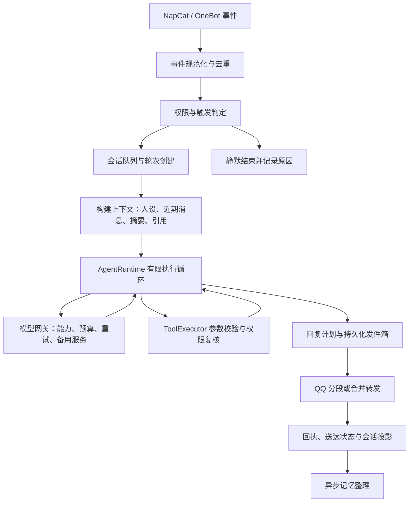

# Agent QQ 聊天架构规范（目标方案）

状态：实现与验收完成。逐项自动验收、真实 QQ 群聊回执及协议回查均通过，用户已确认客户端只收到一次。证据见 [迁移验收核对](chat-migration-audit.md)；第 12 节保留实施过程记录，其中的阶段性待办不代表当前未完成项。

## 1. 范围与原则

QQBot Desktop 管理进程、账号和入口；FLLBot 承担聊天业务；NapCat / OneBot 承担 QQ 协议。
采用单进程模块化架构和 SQLite 持久化，沿用现有插件体系。当前无需拆微服务或引入外部消息中间件。

普通聊天与调用工具是同一轮对话的不同执行方式，共用会话、上下文、预算和发送流程。
所有入口（QQ、管理调试）调用同一应用服务，但管理调试默认不发送 QQ、不执行有副作用工具、不写正式会话。
收到消息、生成答案、执行工具、送达 QQ 是四类不同事实，必须分别记录。

## 2. 端到端流程

记忆采集是单独策略：允许采集的普通群消息即使未触发回答也可以进入背景，但命令、拒绝访问事件和关闭采集期间的消息不得绕过策略进入记忆。

## 3. 模块边界

| 模块 | 唯一职责 | 禁止承担 |
| --- | --- | --- |
| OneBot Adapter | 校验协议、规范化事件、执行发送并返回回执 | 人设、模型选择、工具决策 |
| TriggerPolicy | 权限、群开关、@、唤醒词、概率、冷却，输出决策及原因 | 直接调用模型或发送消息 |
| ConversationService | 会话身份、队列、轮次状态、取消与代次 | 模型协议和具体插件业务 |
| ContextBuilder | 构建不可变上下文快照，控制输入预算 | 发消息、执行工具、改写人设文件 |
| AgentRuntime | 无工具回答、静默、有限工具循环及终止规则 | 拼装 OneBot 参数、直接写 SQL |
| ToolExecutor | 注册工具、参数校验、授权复核、超时与执行记录 | 让模型决定权限 |
| ModelGateway | 模型能力、请求预算、并发、重试、备用、用量 | 会话历史的送达状态 |
| ReplyService | 将文本转为回复计划，分段、引用、@、转发 | 再次生成答案 |
| DeliveryService | 发件箱、指定账号发送、回执、失败与不确定状态 | 自动重跑整轮 Agent |
| MemoryService | 近期背景、话题摘要、作用域内历史检索 | 从聊天内容推导操作授权 |
| Repository | 数据约束、事务、迁移、查询 | 触发规则、网络调用 |
| Trace / Admin API | 阶段诊断、状态查询、受控管理 | 复制一套聊天执行逻辑 |

agent 插件保留配置声明、事件接入和工具注册；复杂执行流程下沉至宿主服务。
服务通过显式构造参数获得依赖，逐步减少 `service.bot.xxx` 对整棵应用对象的访问。
依赖方向为接入层 → 应用服务 → 领域对象与接口；协议、数据库和模型客户端实现接口，由 app.py 装配。

## 4. 核心数据契约

| 对象 | 必须包含 |
| --- | --- |
| MessageEnvelope | event_key、self_id、scene、scene_id、sender_id、message_id、接收时间、消息段、引用信息 |
| ConversationKey | platform、self_id、scene、scene_id |
| TriggerDecision | accept / ignore / reject、reason、trigger_kind、effective_policy_version |
| Turn | turn_id、conversation_key、输入事件、status、deadline、data_epoch、配置版本、trace_id |
| ContextSnapshot | 输入消息、消息来源、引用来源、预算、模型与人设版本、历史截止位置 |
| ToolExecution | execution_id、turn_id、call_id、工具与参数摘要、状态、结果引用、幂等键 |
| ReplyPlan | turn_id、目标账号与会话、回复方式、有序分段、引用目标 |
| DeliveryReceipt | delivery_id、part_index、status、QQ message_id、错误码、尝试时间 |

群场景 scene_id 是群号；私聊是对方 QQ 号。成员身份不是群会话键的一部分，否则群内对话会被切碎。
所有聊天历史、锁、冷却、检索、清理和发送都显式携带 ConversationKey。群费用额度若保留跨 Bot 共享，使用独立 QuotaKey(group_id)，不得混成会话身份。
旧数据没有 self_id 时不猜测归属；保留为 legacy 范围，经明确迁移才参与新账号历史。

## 5. 轮次与并发

轮次主状态：`queued → running → reply_ready → delivering → delivered`。
终止分支：`ignored / silent / failed / cancelled / expired / delivery_uncertain`。
部分送达由分段回执表达，不能把整轮简单标为成功或未发送。

- 同一 ConversationKey 按接收顺序执行；不同会话可并发，共享模型并发上限。
- 每会话队列和全局队列均有容量上限、排队时限与空闲回收，避免群消息挤满工作任务。
- 第一阶段逐条排队，不隐式合并消息。以后增加短窗口合并时必须保留全部来源事件，单独约定 @ 与命令优先级。
- 慢群不能占满 dispatcher 工作者等待会话锁；dispatcher 交付到有界会话队列后退出。
- 每轮固定历史截止位置；排队后的新消息不能偶然混入正在构建的上下文。
- deadline 覆盖排队、模型和工具执行；下游超时不超过剩余时限。
- 清空历史、停用账号和关闭服务触发取消或代次失效；工具执行与每段发送前重新检查。已发生的外部动作保留执行记录，不能宣称已撤回。
- 锁获取顺序固定，数据库事务不跨网络 await；队列负责会话串行，额度服务独立保护预算。

## 6. 上下文与记忆

输入顺序：系统约束 → 人设与场景规则 → 标注来源的摘要 → 近期原文 → 当前消息与引用。
引用、历史、网页和工具结果都是参考数据，不具备系统指令或新操作授权的效力。
上下文保留群成员身份并遵守昵称、QQ 号、身份和时间开关；管理页面不得另造一套格式。

预算预留包含系统提示、工具定义、图片、最大输出和备用模型容量。优先删除较早背景，再缩减摘要；当前输入过大时明确报告，不能无提示地截掉用户请求。
群记忆按账号和群隔离；私聊按账号和用户隔离。长期偏好以后单独设计用户查看、修改、删除和来源追溯，不把一次请求自动当作永久偏好。
摘要在主回复路径之后交由有界后台任务执行，失败保留原文。摘要提交核对来源仍存在及 data_epoch，不能在清空后重新写回旧内容。
生成但未送达的答案只存为候选回复；下一轮不得将它当作用户已经看见的回答。部分送达时只将成功分段投影为可见历史。

## 7. 工具执行规范

工具定义包括名称、JSON Schema、权限、超时、返回大小上限，以及 read_only / idempotent / side_effecting 分类。
开放工具取插件启用、会话白名单、用户权限、模型能力的交集；执行前再次检查，不仅检查生成工具列表时的权限。
参数必须通过 schema 校验；未知字段、缺少参数、截断 JSON 和不存在工具均转为结构化失败结果。
限制每轮工具次数、模型轮数、总耗时和工具输出大小，静默决策不与有副作用调用混合执行。

持久化执行记录后再调用有副作用工具；支持幂等的工具传入 execution_id 作为幂等键。
外部系统未支持幂等时，超时或崩溃后标为 uncertain，不自动重试。工具已经成功但后续模型失败，保留工具成功事实，只允许继续生成解释。
需要授权的工具沿用宿主工具权限机制；不因为普通聊天额外增加统一确认弹窗。

## 8. 可靠发送与故障规则

候选回复与发件箱在同一数据库事务保存，事务完成后再调用 OneBot。
分段状态：`pending → sending → sent / failed / uncertain`，每段使用稳定的 delivery_id 与 part_index。
发送成功记录 QQ message_id；发送前再次检查账号连接、权限与代次，不切换到其他账号代发。
进程重启后的 sending 进入 uncertain，禁止盲目重发。OneBot 不能保证端到端 exactly-once；本方案保证本地可追踪，并避免对不确定发送自动重复操作。

| 故障 | 行为 |
| --- | --- |
| 临时模型故障 | 沿用有界重试与备用服务，只重试模型请求 |
| 模型已输出或工具已执行 | 不重启整轮，不重复工具 |
| 额度不足 / 队列拥塞 | 返回明确原因，自动参与场景避免刷屏 |
| 显式静默 | silent，无 QQ 输出 |
| 空白响应 | 独立 reason，不等同于显式静默；直问场景返回简短失败提示 |
| 转发明确拒绝 | 可降级分段；超时等送达不确定情况不自动降级重发 |
| 某段发送失败 | 保留已成功分段，只处理明确未发送部分 |
| 数据库提交失败 | 不发送尚未持久化的候选回复，记录可诊断失败 |

## 9. 存储、配置与观测

建议新增或迁移：conversations、turns、turn_messages、tool_executions、reply_deliveries、delivery_parts。
事件唯一键包含账号、事件类型、场景与协议消息标识；没有稳定协议标识时使用有时限去重，明确其不能提供持久唯一性。
常查索引覆盖会话时间、轮次状态、发件箱状态；唯一约束保护 event_key 和分段身份。
清理覆盖正文、摘要、候选回复与工具结果；诊断和审计默认仅保留元数据，沿用现有预览、事务和代次失效机制。

沿用现有 policy / agent_settings 解析器，不新增第二套覆盖规则。普通选择项按群显式覆盖 → Bot 默认 → 全局默认解析；硬关闭与权限拒绝优先。
每轮保留有效配置版本；发送和工具执行仍按最新权限复核。配置更新不修改运行中轮次的上下文快照。

trace_id 串联接收、触发、排队、上下文、模型、工具、发送和清理。每次模型请求记录输入上下文估算与模型窗口、输出 token 上限；完成后记录输入 / 输出 token 用量、来源（服务商实报或估算）、finish_reason 和耗时。至少记录等待时间、首响应时间、总耗时、token / 费用、重试、静默原因、送达成功率与 uncertain 数量。日志只保留请求元数据，不写完整聊天正文。
日志默认不写密钥和完整聊天；正文调试需单独开关和保留期限。管理页可展示“为什么没回”“模型失败还是发送失败”，重试动作不能直接重跑已执行工具。

## 10. 现有代码与迁移顺序

已有基础：app.py 的事件去重、dispatcher 的工作队列、policy 的策略解析、ChatService / LLMClient、GroupMemory、agent 工具循环、output.py 的 QQ 输出、tracing 和清理代次。
以下是本次阅读发现的边界问题与后续工作，并非全部经过故障复现：

| 阶段 | 改造范围 | 完成标准 |
| --- | --- | --- |
| P0 会话统一 | 引入 ConversationKey；统一 agent 与 ChatService 的锁、历史与轮次入口 | 同群不同账号和私聊历史隔离；两个入口不绕过同一串行机制 |
| P0 送达事实 | 回复候选与已发送历史分离；引入分段回执和 uncertain | 发送失败时下一轮不声称用户已看到答案；超时不重复降级发送 |
| P1 执行收口 | 提取 ConversationService、ContextBuilder、AgentRuntime、ToolExecutor | agent 插件只负责接入；普通回答与工具回答走同一流程 |
| P1 队列治理 | 有界会话队列、deadline、取消、空闲回收 | 热门群不会长期占满其他会话的工作任务 |
| P1 工具恢复 | 执行记录、幂等键、权限复核 | 后续模型失败和进程重启都不会重跑成功工具 |
| P2 记忆后台化 | 摘要有界任务、固定历史截止点 | 摘要延迟不阻塞主回答；清空后旧任务不能恢复记忆 |
| P2 管理闭环 | 轮次查询、失败原因、分段状态、受控恢复 | 后台和 QQ 使用同一业务事实 |

具体依据：agent/plugin.py 有独立工具循环与 `(self_id, group_id)` 锁；llm/chat.py 的 respond 使用 `scene:scene_id` 锁，普通历史读写未显式传 self_id；两处回复路径存在发送前保存 assistant 历史的行为。output.py 当前对转发异常统一降级分段，应区分明确拒绝与送达不确定。
这些改造先补明确行为契约，再迁移实现；保留现有模型能力、权限、清理与插件 API 的兼容行为。

## 11. 必须覆盖的验收场景

1. 同 QQ 消息重复上报只创建一轮；不同账号消息 ID 相同不互相去重。
2. 同群消息有序；不同群可并发；队列满和等待过期有明确处理。
3. 私聊与群聊、两个 Bot、历史检索和引用均无跨范围串话。
4. 群 AI 关闭、插件关闭、用户无权限、未唤醒、冷却和静默可分别解释。
5. 工具参数非法不执行；执行期间权限撤销会阻止尚未开始的动作。
6. 工具成功后模型超时不重跑工具；有副作用工具状态不确定时不自动重试。
7. 模型截断、空响应、备用服务、超预算均沿用明确终止规则。
8. 第一段成功第二段失败、OneBot 超时、转发拒绝与进程重启不造成整条重复回复。
9. 清空历史与账号停用可阻止旧轮次后续写入、工具和发送；已产生的外部动作保留事实。
10. 超长消息、图片、合并转发、引用和超长工具结果不突破上下文预算。

使用模拟模型、模拟 OneBot 和临时数据库验证以上行为；迁移时运行现有聊天、权限、记忆、清理及架构检查。真实 QQ 联调最后执行，不在自动测试中发送消息。

## 12. 迁移过程记录（2026-11-04）

以下按实施顺序保留阶段记录；当前状态及剩余验收以文首和 chat-migration-audit.md 为准。

已落地并通过局部回归：

- ConversationKey；agent 与普通回复使用同一账号/场景会话锁。
- chat_messages 增加 self_id，已有记录保留在 0（legacy）范围；QQ 新回复显式传账号。
- reply_deliveries 与 delivery_parts 保存候选和分段事实，发送前提交；仅成功分段进入 assistant 历史与群记忆。
- 明确 OneBot 拒绝才允许转发降级；超时记录 uncertain，不自动重发；重启将 sending 改为 uncertain。
- 发件记录纳入会话清理预览、事务删除及代次失效；每段发送前复核群/插件/处理器权限及账号。
- 回归覆盖部分送达、超时不重发、重启不确定状态、清理账号范围及分段期间关闭群。

仍待迁移：统一轮次持久化及管理调试入口、有界会话队列与 deadline、执行器与工具事实持久化、
固定上下文截止点与后台摘要、轮次管理查询与受控恢复。现有锁和代次机制只是迁移基础，
不能视为上述阶段全部完成。账号停用还需与统一轮次取消对接；旧管理历史接口仍使用 legacy 范围。

队列迁移补充：dispatcher 使用按 ConversationKey 分组的有界公平队列，同会话仅一个事件运行；
完成后回到就绪队列尾部，没有待处理消息时回收会话槽位。全局待处理上限沿用 max_pending_events，
单会话待处理上限 max_pending_per_conversation（默认 32），queue_timeout_seconds（默认 30 秒）
限制排队等待，event_deadline_seconds（默认 120 秒）覆盖从入队到处理结束。超时会取消当前处理，
发送路径保留 uncertain。直接 dispatch 的测试/管理调用尚未接入该队列；统一应用轮次服务仍待实现。

工具执行器迁移补充：新增宿主 ToolExecutor，由 app.py 显式注入 storage 和 permissions。
agent 的 _run_tool 仅转交执行；宿主完成 JSON Schema 参数校验、最新工具白名单/插件权限复核、
回调超时与执行事实持久化。AIToolSpec 新增 effect、timeout、max_output_chars，默认按有副作用处理；
支持幂等的插件可读取 ctx.tool_execution_id 作为外部幂等键。执行前提交 running，成功记录 succeeded，
副作用异常/超时标为 uncertain；重启将遗留 running 转为 uncertain。执行表仅保存元数据，不保存参数正文。

尚缺少与持久化 turn_id / call_id 的关联和调用去重、结果引用与受控恢复，不能视为 P1 工具恢复已完成。
已有工具需逐个标注 read_only/idempotent，并验证真实外部系统的幂等支持；当前默认不重试工具回调。

调用恢复迁移补充：Context 为有稳定协议消息号的消息构造账号/场景隔离的 turn_id，
工具执行持久化 turn_id、call_id 和参数摘要；数据库唯一约束保护重复调用。
相同调用成功时复用已保存结果，运行中、失败或 uncertain 均不自动重执行；参数不一致直接拒绝。
工具结果单独存 tool_results，纳入会话清理；清理后仍保留执行元数据，禁止通过重放调用恢复被清理的正文。
无模型 call_id 时按轮数与调用位置生成本轮调用标识；无稳定协议消息号时仅使用临时轮次身份。
这些标识尚未接入持久化 turns 状态机，轮次服务、后台恢复入口仍未完成。

轮次状态迁移补充：新增 ConversationService（storage、会话锁工厂、配置提供器显式注入）。
普通 respond、agent 模型路径及固定唤醒回复共用轮次入口，先以 turn_id 唯一约束认领 queued，
再进入会话锁并转 running；候选提交为 reply_ready，协议发送为 delivering。
离开轮次时根据分段事实确定 delivered / failed / delivery_uncertain / cancelled / expired / silent。
轮次保存账号场景、消息号、deadline、data_epoch、配置摘要和 trace_id，回复发件箱关联 turn_id。
重启不会重开中断轮次；遗留 delivering 标记 delivery_uncertain，其他进行中轮次标记 cancelled。

尚待收口：管理调试的统一应用入口、接收至排队阶段的轮次记录与代次快照、拒绝/未触发原因的
结构化决策、上下文截止点和版本快照、账号停用取消、持久化轮次查询及受控恢复 API。
ConversationService 与 dispatcher 已共享入队时捕获的 deadline，详见后续接收快照补充。

接收快照迁移补充：不可变 ReceiveSnapshot 在 dispatcher 入队时固定接收时间、数据代次、
单调时钟截止时间及排队截止时间，通过任务局部作用域传递到 Context 和 ConversationService。
队列项启动前核对代次，清理前排队的事件不会以新代次重新采集记忆或执行模型。
轮次表保存同一接收截止时间；工具超时取工具自身上限与轮次剩余时间的较小值。
直接构造 Context 时在构造处捕获快照，管理调试统一入口仍待迁移。
已覆盖工作任务被占用时入队、清空历史、释放任务后旧事件被丢弃，以及上下文/轮次沿用同一截止时间的测试。

上下文与调试入口迁移补充：ContextBuilder 输出不可变 ContextSnapshot，保留序列化消息、
历史时间截止点、配置摘要、系统/人设提示摘要及选定模型信息。普通历史查询显式使用截止时间；
调用方取得独立消息副本，工具循环追加内容不会修改快照。已有提示格式与预算算法仍由 ChatService 兼容实现。
普通 respond 与管理 /llm/chat 共用 generate；管理端路由只转交 preview，由宿主负责会话锁、
截止时间、清理代次及显式保存。调试默认无 QQ 发送、无工具、无历史写入；旧 save=true 行为限定在
账号 0 的 legacy 调试范围，不参与已隔离的 QQ 账号历史。
指定调试 provider 同时用于上下文容量选择与模型调用，避免预算按另一服务估算。

尚未完成：agent 工具定义与后续工具结果的统一预算、群记忆后台摘要、管理调试接入持久化轮次与
真实账号只读快照、完整 ContextBuilder 职责迁移，以及配置变更期间所有格式和预算的固定版本读取。

后台摘要迁移补充：上下文构建只读已有摘要并记录本轮压缩边界，不等待摘要模型请求。
ConversationService 在前台轮次完成后交给 GroupMemory.schedule；使用容量 64 的队列和单个后台工作任务，
同账号/群去重排队，满队列丢弃新整理请求但保留全部原文。任务持有独立上下文副本，避免插件后续修改污染任务。
后台摘要不继承已结束轮次的追踪和接收作用域；模型调用仍遵守已有模型并发与额度限制。
停止服务时先取消摘要工作任务并清空待整理请求，再关闭模型客户端和数据库。
摘要提交同时校验隐私版本、记忆启用状态、来源消息存在性及 data_epoch；代次失效不能写回旧摘要。
已验证慢摘要不阻塞上下文构建、单会话去重、队列上限，以及原文仍在但代次变化时拒绝提交摘要。

仍待完成的主要路径：统一 AgentRuntime 与 ContextBuilder 完整预算职责、结构化 TriggerDecision、
管理轮次查询/受控恢复、管理调试真实账号只读快照、账号停用取消和按验收场景的最终审计。

运行时迁移补充：AgentRuntime 已接管有限模型/工具循环，由 app.py 注入模型调用接口；
普通 generate 与 agent 工具回答都通过该运行时。运行时不写 SQL、不拼 OneBot 参数，返回正文、
静默/空响应/工具完成/轮数上限等结果，由接入服务继续记录输入与交付回复。
静默工具在任何其他工具动作之前处理；最多 5 个工具轮次，每轮最多执行 3 个工具；
后续模型失败直接结束当前执行，不重启工具循环。工具轮数耗尽的提示也走持久化发件箱。
显式静默、空白响应和工具已对外完成分别保留原因；被 @ 的直问遇到空白响应会发送简短失败提示。
普通 respond 已移除固定 2000 字符的无提示输入截断，输入是否可接受交给最终请求预算校验。

仍需完成统一应用服务对输入记录和 ReplyService 的提取、结构化触发决策、完整上下文版本冻结、
账号停用取消、管理轮次状态查询和受控恢复，以及最终按 11 节逐项验收。

管理诊断迁移补充：提供鉴权的 `/api/console/turns` 列表与详情接口，支持账号/场景/状态筛选、
游标分页；详情关联分段回执和工具状态，仅返回元数据。ConversationService 跟踪进行中的任务，
`POST /api/console/turns/{turn_id}/cancel` 记录管理操作后发起取消，上下文立即失效，后续工具与发送被阻止。
取消不修改已完成的工具或分段事实；若协议调用正在进行，终态保留 delivery_uncertain。
终态不可通过该接口重新启动，can_retry 当前固定 false；细粒度的安全分段恢复尚待实现。
已验证接口鉴权、账号筛选、不暴露正文、运行中取消及终态拒绝重启。

账号停用迁移补充：BotProfiles 增加持久化 enabled 与 account_epoch，独立于 BotDefaults.reply_mode。
管理端提供账号 state 写入接口；状态改变推进账号代次，停用取消该账号进行中的轮次。
ReceiveSnapshot 捕获账号代次，dispatcher 启动队列项前复核；Context.data_current 同时核对
全局清理代次、账号开关、账号代次和轮次取消标记，工具、发送与后台摘要沿用同一检查。
重新启用和重启不会复活旧上下文/队列项；其他账号的代次不受影响。协议连接仍可保持在线。
已验证鉴权、运行中取消、停用状态重启保留，以及停用后重新启用仍丢弃旧排队消息。

管理界面迁移补充：消息诊断页增加聊天轮次面板，支持账号/会话/状态筛选、分页、工具和分段状态详情，
以及当前轮次的取消操作。账号默认设置页增加独立聊天启停操作，沿用账号 revision 防止覆盖并发更新；
启停不提交或清除正在编辑的默认值草稿。诊断内容通过文本节点呈现，不显示候选和工具结果正文。
已通过模拟账号/部分发送失败数据的本地无界面浏览器布局检查；未连接真实 QQ 或执行真实工具。
安全分段恢复仍未提供，界面不会通过重跑整轮来恢复工具或不确定发送。

分段恢复迁移补充：新增 DeliveryService，显式注入存储、原账号上下文工厂、会话锁和成功历史投影回调。
发件计划额外保存恢复所需账号代次、原用户、插件、处理器权限与回复方式。恢复接口通过数据库原子认领
失败轮次，使用同会话锁，只恢复 split 计划中明确 failed/pending 分段；每段前复核原账号及权限，
有群权限要求时重新查询成员身份。复用原 delivery_id/part_index，成功分段只投影一次；不重新生成答案或执行工具。
存在 uncertain/sending、账号代次变化、清理、取消或缺少元数据时禁止恢复；转发计划暂不提供恢复。
恢复超时仍保留 uncertain，禁止随后重发；界面仅在存储层认定可恢复时显示补发按钮，执行时再次复核实时权限。
转发明确拒绝后原转发分段标记 superseded，以免分段降级全部成功仍将轮次错误判为失败。

触发策略迁移补充：新增宿主 TriggerPolicy，显式注入已有策略解析器、权限、模型可用性和唤醒词查询。
插件接入改为消费 TriggerDecision，接受/忽略/拒绝均携带 reason、trigger_kind 和 effective_policy_version。
策略沿用 agent_settings，不增加另一套覆盖规则；唤醒词处理、固定回复、概率与冷却判定已从插件下沉。
结构化 trigger_decisions 只保存元数据，权限/群准入及插件关闭导致的提前拒绝也由 dispatcher 记录；
记录纳入 traces 保留/清理范围。管理鉴权接口 `/api/console/trigger-decisions` 支持账号、会话筛选和游标分页。
已验证策略版本变更、未触发原因、拒绝访问不进入记忆、诊断不保存正文以及现有触发模式兼容。

最终验收仍需补齐完整上下文版本冻结与来源预算、管理调试真实账号与持久化轮次、轮次接收/排队阶段的
事实覆盖、清理和停用的并发写回竞态，以及工具和恢复动作的全生命周期取消/观测。

写回竞态修正补充：账号资料的提交和运行时账号版本发布现在都在 storage.data_lock 内完成，
聊天正文、原始记忆、摘要、工具结果和候选计划获得该锁后再次核对 account_epoch。
成功发送/工具成功仍记录事实；若账号代次已失效，则阻止正文投影和工具结果写回。
可控锁屏障测试覆盖六类排队提交，并验证停用再启用不会复活正文、已发生的外部事实仍保留。
恢复发送已纳入 ConversationService 的任务跟踪，可由管理取消或账号停用中断；
正在等待协议回执的恢复被取消时保存 uncertain，而不是回退到可重发状态。
逐项未完成项另见 [迁移验收核对](chat-migration-audit.md)。

回复计划迁移补充：新增纯 ReplyService 与不可变 ReplyPlan/ReplyPart，明确账号、会话、引用目标、
@ 目标、原始分段、转发名称和发送间隔；分段算法移入该模块，ChatService 的 split_text 导出保持兼容。
发送前一次构造计划，持久化各分段的完整 OneBot 消息段；后续发送和恢复都使用原计划，不读取新格式配置。
轮次开始时冻结回复设置，避免模型生成期间格式变化影响本轮交付。恢复沿用原引用、@ 与发送间隔，
缺少格式版本或分段内容的旧计划禁止恢复。
转发明确拒绝且主分段已 superseded 时，可恢复降级路径中明确未发送的普通分段；
转发发送不确定、成功或未进入降级路径时仍禁止通过恢复接口重发原转发。
已验证格式对象不可变、恢复期间配置变化不改变原计划，以及转发降级只补发失败分段。

运行配置冻结迁移补充：新增任务局部 ExecutionConfig，在轮次首次数据库等待前深拷贝模型配置、
群场景覆盖、账号默认值和人格库内容；上下文构建、模型预算、后续工具轮次模型调用共享该快照。
直接 generate/build_messages/complete 入口也建立同样的局部作用域；嵌套调用复用，退出后恢复原配置，
不同任务不共享可变覆盖。ContextBuilder 记录的配置摘要与实际模型执行读取相同配置。
群 AI 硬开关、账号代次、插件/工具权限及记忆采集允许状态保持实时复核，不被模型配置快照冻结。
已验证模型容量查询等待期间更换模型/输出预算/人设不会改变当前请求，群 AI 关闭仍立即生效，
以及等待会话锁期间的人设变更不污染已创建轮次。

管理调试轮次迁移补充：preview 现已使用同一 ConversationService、执行配置快照、ContextBuilder 和 AgentRuntime，
轮次以 entrypoint=admin_debug 区分，返回 turn_id，可查询失败或通过同一取消接口中断。
调试上下文使用无协议方法的连接对象；不开放工具，不创建 QQ 发件箱，不将候选投影为已送达。
成功调试记录为 silent/admin_debug_completed，明确表示未发送 QQ；未保存的测试仅保留轮次元数据。
新增 self_id 只读账号视角，读取该账号/场景历史且共用会话串行机制；真实账号调试禁止 save=true，
原账号 0 的独立调试显式 save 行为保持兼容，不参与已隔离 QQ 账号历史。
对话测试页已改用 /llm/chat，可选择账号、场景和只读历史，并从结果跳转对应轮次。
已验证历史账号隔离、无发件箱/工具、模型失败诊断及管理取消。

接收事实迁移补充：新增不可变 MessageEnvelope（账号、场景、发送者、原消息段、引用、接收时间、
事件键与轮次标识）。正式 OneBot 消息入口使用异步 enqueue，先在 message_events 提交仅元数据的接收事实，
再交付有界队列；稳定消息标识的唯一约束按账号和场景隔离，进程重启后的重放不会再次派发。
队列状态记录 queued/processing/completed/dropped/expired/cancelled/failed，并关联 trace_id 和 turn_id；
入队后的异步状态提交不能覆盖已经推进的终态。无协议消息号使用临时轮次标识，正式入口仅在内存 TTL 内
按规范化事件指纹去重，不能提供持久唯一性，也可能将时间和内容完全相同的事件视为重复。
接收记录纳入 traces 保留清理，管理接口 `/api/console/message-events` 可查询不含正文的接收和排队状态。
分发层直接同步 emit 保持兼容；正式入口使用 enqueue。取消单轮不会退出固定分发工作任务；
停服丢弃的待处理项保存 cancelled，重启将未完成的接收/排队事实标记 process_restart。
已验证跨重启持久去重、账号和场景隔离、拥塞丢弃、无稳定标识的轮次关联和取消后工作任务存活。

统一容量治理迁移补充：QQ 分发入队、直接业务轮次、管理调试和分段恢复共用 ConversationCapacity。
全局总占用上限为 max_pending_events 加固定工作任务数量，单会话上限为 max_pending_per_conversation 加一个活动槽位；
QQ 轮次复用入队占用，不二次计数。队列丢弃、过期、取消、停服及直接入口退出均释放票据，空闲计数键立即回收。
管理调试容量不足返回 429，并持久化失败轮次与 global_queue_full/conversation_queue_full 原因。
直接轮次与恢复等待会话锁时也遵守接收时确定的排队截止时间，排队超时不进入模型或发送阶段。
会话与额度锁改为引用计数租约池，活动/等待者全部退出后回收锁槽位，保留账号会话隔离与跨 Bot 群额度语义。
状态接口的 dispatcher.conversation_admission 暴露当前占用和上限；无聊天正文。
已验证 QQ 入队会限制直接调试、容量拒绝不执行、过期释放、停服释放，以及同会话串行和空闲锁回收。

输入与生成事实迁移补充：新增 turn_messages，QQ 业务轮次与本轮输入在同一事务提交，模型尚未调用时
已保存输入事实；事务失败回滚整个轮次认领，不开始执行。未保存的管理调试仍不保存输入正文。
llm_usage 增加 turn_id，轮次任务局部作用域将后续多轮模型请求关联到同一轮次；摘要后台任务使用独立作用域。
轮次详情与界面展示模型请求状态/用量/耗时，与工具执行及分段送达分开，接口不返回输入正文或工具结果。
turn_messages 随会话清理预览/删除并触发代次失效，清空历史也覆盖本轮输入；模型用量元数据保留为独立事实。
共享数据库连接上旧的消息、诊断、KV 和统计提交已统一使用数据锁与异常回滚，避免后台写入提前提交
轮次输入、候选计划或清理事务。已用等待屏障验证输入写入失败时后台用量无法提交半个轮次。

管理历史范围迁移补充：会话目录按 self_id/scene/scene_id 分组，包含已采集但未触发回复的群记忆，
不再将同群不同账号合并。历史查询和清空接口接收 self_id，默认 0 仅表示 legacy/独立调试范围；
页面选中会话后所有读取和删除都携带账号，标题明确显示 Bot 或 legacy，不推断旧记录归属。
群历史优先读取该账号群记忆原文，没有记忆时回退到该账号普通聊天历史。
指定账号清空覆盖其聊天正文、轮次输入、群原文/摘要、候选和工具结果，不删除其他账号正文或外部动作元数据。
会话保留清理也已允许 self_id 过滤；用量和配置变更仍保留原有非账号语义。
Storage.clear_chat 的 self_id=None 仅保留给旧内部批量调用，新的管理入口和 ChatService.clear 显式传账号。
当前精确清空仍推进全局清理代次，对其他会话运行中任务会保守失效；细粒度取消隔离需继续迁移。
已验证同群两账号及 legacy 的读取/删除隔离，候选、工具结果和记忆不跨范围删除。

精确会话代次迁移补充：新增持久化 conversation_epochs，按 self_id/scene/scene_id 保存精确清理代次，
与清理正文同一事务提交后再发布运行时版本；重启重新加载版本，候选恢复不会误用旧代次。
接收快照、轮次和发件元数据保存 scope_epoch；队列、Context、历史写入、原始记忆、摘要、工具结果和
成功分段投影均复核会话代次。指定账号及场景的精确清空不再使其他账号/其他群运行中任务失效。
不限定完整会话的批量清理仍使用全局代次，兼容旧内部批量调用。会话或全局数据失效的旧轮次终态优先记为 cancelled，
不会因模型等待被中断而误报普通执行失败。已验证同群其他账号继续、旧写入拒绝、仅目标排队项丢弃及重启版本保留。

清理回执保留修正：reply_deliveries 增加 bodies_cleared。清空会话和保留清理现在擦除候选正文、
分段正文与格式数据，保留 delivery_id、分段索引、发送状态、QQ message_id、错误类别和尝试时间。
尚未开始的 pending 分段转 cancelled；sending 保留等待实际回执，迟到的成功/不确定结果仍能提交。
已清理计划禁止重新开始发送、降级或恢复，也不再投影正文到历史。分段状态迁移已限制非法终态回退。
保留清理仅统计未清理正文的计划，重复预览不会再次计入已经擦除的正文；回执元数据仍可查询。
已验证手动清空和保留清理在发送等待中发生时，迟到成功/超时事实保留、后续分段停止、正文不复活。

记忆策略提交竞态修正：接收快照增加 memory_allowed，正式入队前固定该消息当时的采集许可；
Context、原文采集和后续摘要同时遵守接收许可与最新硬开关，关闭期间收到的消息不会在重新开启后回填。
原文/可见回复记忆提交及摘要提交使用 settings_lock → data_lock 固定顺序，在持锁后重新检查群、
插件、自动参与、模型场景、账号/数据代次和隐私开关。模型请求与上下文构建仍在锁外执行。
摘要最终隐私检查明确读取实时配置，不使用轮次冻结的模型格式配置，避免旧执行作用域掩盖隐私撤销。
已通过群/插件/自动参与/群 AI/记忆/隐私六类提交等待屏障测试、关闭期间入队后重新启用测试，
以及冻结模型配置内隐私撤销测试。失败或被拒绝的整理始终保留已授权原文。

停服边界迁移补充：停止过程首先关闭共享准入和分发入口，标记服务生命周期失效，取消并等待进行中的
业务轮次/管理调试/恢复任务退出，再停止摘要、连接、插件、诊断和数据库。任务跟踪覆盖轮次创建及等待会话锁阶段，
不只覆盖已经 running 的任务。发送中被取消保留 uncertain，副作用工具被取消先提交 uncertain，再关闭存储。
停服流程由独立任务执行并受 shield 保护，处理器自身请求停服不会让数据库先于自己的终态提交关闭。
Storage.close 也等待数据锁，避免切断正在提交的共享连接写入；诊断关闭后拒绝迟到提交，不重启写入队列。
关闭期间的新调试/恢复入口返回 503，新的 OneBot 接收不再写入数据库；旧 Context 带生命周期代次，
同实例重启可重新开放准入和摘要，但不能复活旧上下文。已验证发送等待、模型调试、工具执行、处理器自身停服及重启。

非协作异步工具超时修正：ToolExecutor 将回调置于独立任务，使用有界等待而不等待回调完成取消。
超时/轮次取消时先失效执行上下文并提交 failed（只读）或 uncertain（可能有副作用），主流程及时结束。
迟到成功结果不会改写执行事实或保存旧结果；每次回调使用独立上下文，继承父轮次失效检查，
通过该上下文及其连接发起的迟到协议动作会被拒绝。已启动的外部请求仍按不确定事实处理，不能宣称已撤回。
所有尚未退出的回调占有最多 32 个回调槽位，未释放时新工具返回 tool_executor_busy，避免超时回调无限堆积。
停服取消执行请求后不无限等待吞掉取消的回调；迟到任务结束仅回收槽位和消费异常，不再写入已关闭的数据库。
状态接口提供 tool_executor 的回调数、上限、过期回调数和关闭状态。已验证吞掉 CancelledError 的异步回调
不拖住超时或停服、迟到回复/协议撤回不执行、结果不写回和回调槽位耗尽时拒绝新工具。
这不是任意插件代码的进程隔离；工具已经自行发出的外部动作仍需依靠其幂等接口和执行元数据追踪。

### 工具结果与分类验收补充

工具结果按最终序列化字符数限制，包含 JSON 转义与截断元数据；迭代编码只收集有界前缀，
截断后仍返回合法 JSON。持久化结果与模型收到的结果相同，重复 call_id 复用已保存的有界结果。
注册时拒绝无效 effect、非有限/非正超时及小于 64 字符的输出上限。

现有工具逐项标注：运行状态、历史检索、网络搜索/网页/天气/时间、待办查询、群资料查询、
群成员查询和引用读取为 read_only；创建/完成/取消待办、保存/删除群资料、语音发送为 side_effecting。
当前外部写工具没有提供可验证的 execution_id 幂等协议，因此不标为 idempotent。
管理工具目录和插件元数据提供 effect、timeout、max_output_chars，便于核对实际生效契约。

工具容量在持久化 claim 返回后、创建回调前再次检查，避免并发数据库等待期间同时越过上限。
回归覆盖引号/反斜杠/换行与中文大结果、合法截断 JSON、结果保存与重复复用、无效注册配置、
并发 claim 槽位上限，以及只读超时 failed 与写操作超时 uncertain 的区别。

### 语音延迟动作闭环

voice__speak 现在等待有界 FIFO 任务完成，timeout 为 120 秒且受本轮剩余 deadline 限制。
队列最多 32 项等待任务，每项冻结上下文与任务局部配置；工具等待取消会同时取消排队/生成子任务。
后台命令继续排队，队满明确提示；工作任务纳入 ConversationService 生命周期跟踪，停机/卸载清空队列。

合成开始、每批开始、缓存落盘和发送前均复核上下文、账号、群/插件/语音设置。
工具上下文增加实时 guard：插件、入口权限、白名单、会话开关与时限在后续宿主操作前重新检查。
异步协议包装在协程真正执行时检查，不能在撤权前取得协程再延迟执行来绕过权限。

媒体使用独立 outbox 模式，发送前原子保存候选与段内容，sent/failed/uncertain 保留实际 QQ 回执。
只有成功语音片段进入 assistant 历史和记忆；首个媒体回复前投影对应用户输入，保持输入先于回答。
agent 不再把工具自报 spoken 直接存为已送达的 assistant，也不会重复投影完整朗读文本。
媒体模式禁止管理端普通分段恢复，任何重放都不应自动重复语音动作。

新增模拟测试覆盖完整 agent 语音入口、等待实际回执、只投影一次、部分送达、合成后撤权/关闭/清空、
发送中取消保留 uncertain、队列上限及停机丢弃等待任务；所有合成和 OneBot 调用均为本地模拟。

### 上下文快照与最终预算验收补充

ContextBuilder 在上下文 I/O 前冻结工具定义，将智能体额外规则纳入序列化消息，
不再由 agent 在快照生成后追加系统规则。快照提供独立复制的消息/工具、来源范围与引用标识、
历史截止点、配置/提示/请求版本和主备服务预算参数。主备模型的窗口、图片预留、输出预留与
输入估算一起记录；实际每次请求仍由模型客户端依据当前轮冻结配置再次执行最终预算检查。

群记忆原文带内部 message_id 来源，摘要带 first_id/last_id 和来源标签；旧原文先于摘要移除，
摘要缩减保留来源说明，当前请求不静默截断。内部来源字段不计入网络协议正文，也不发送给模型服务。
工具定义按轮复制；执行复核会拒绝已更换回调、参数契约或 effect 的工具，并同时检查最新权限，
避免模型基于旧定义发起调用后执行不兼容的新工具实现。

数据库 v22 为 turns 增加 context_metadata；仅保存版本哈希、模型/工具名称、来源数量与预算，
不保存提示、聊天、工具说明或密钥。轮次详情页展示快照版本、截止点和各服务预算；
会话正文清理后保留这些元数据，便于核对历史执行事实。

新增 test_context_contract 验证工具在上下文 I/O 前冻结、规则属于快照、摘要裁剪顺序、
含图片与工具的较小备用模型实际请求不超预算、宿主来源字段不外传、过大规则/定义在网络前拒绝，
以及快照元数据在正文清理和重启后仍存在且不包含正文或密钥。

### 引用与转发来源统一补充

agent 不再在轮次创建前自行展开转发；普通聊天与 agent 在固定执行配置的上下文构建中调用同一读取器。
原始接收内容仍作为 turn_messages 的输入事实，展开后的 context_input 只用于本轮上下文与后续可见用户历史。
唤醒词专用模型提示不会因此冒充用户原文进入历史；工具语音所用的输入投影也复用同一展开内容。

转发来源显式标为 current_attachment，记录被引用的资源 ID、读取次数、展开节点数、错误和截断情况。
附件可包含用户主动提供的其他聊天资料，它不属于宿主历史检索，不具备当前操作授权；普通聊天也收到这一系统约束。
转发作者的昵称、QQ、身份和时间均遵守当前轮冻结的身份发送开关，缺少信息时不猜测身份。

同一事件的转发只读取一次；读取总时限最多 5 秒并受本轮剩余时限约束，所有附件及嵌套共享 50 节点/6 次读取上限。
嵌套深度最多 2 层，最终展开上限保持 4000 字，超限记录截断。引用仍需验证原消息属于当前会话；
失效上下文不重新读取或复用引用缓存。事件 self_id 与连接账号不一致时，在入队/执行前拒绝；
QQ 上下文也检查实际连接账号，防止使用另一 Bot 的连接读取引用与转发。

模拟测试覆盖共用普通聊天入口、身份信息开关、来源快照与轮次来源统计、重复构建不重读、
总读取超时、跨多个附件的全局节点上限以及错误账号不读取附件/不入队。

### 上下文与模型网关模块落位

新增 ContextAssembler，以显式注入的配置/人设/路由读取器、历史读取器、记忆和模型能力客户端，
完成系统提示、身份格式、历史、引用、转发及图片组装；它不保存应用对象，不写会话，也不执行模型生成。
ContextBuilder 继续生成不可变快照，实际组装不再回调 ChatService 的实现。

新增 ModelGateway，以显式注入的配置、客户端读取器、路由器、执行配置作用域和用量 Repository，
统一模型请求、跨账号共享的群额度锁、保守额度预留、成功/失败用量、截断响应处理与运行指标。
模型能力、重试、备用、并发与最终预算由其 LLMClient 依赖处理。网关不读取会话历史、不处理 QQ 送达。
ChatReply 移到网关模块；旧 import 路径及 ChatService 完成/状态/格式化调用继续兼容。

app.py 显式装配 chat_memory、model_gateway、context_assembler、context_builder 并注入 ChatService。
ChatService 仅保留兼容门面、配置选择与对话流程协调；直接构造 ChatService 的旧用法仍有默认装配路径。
任务局部配置读取和客户端替换保持延迟绑定，避免绕过原有配置冻结和测试/插件客户端注入。

新增独立组件测试在不构造 FLLBot、不启动数据库或 QQ 的情况下完成历史组装、快照、模拟模型请求及
成功/失败用量关联。架构检查增加模块级限制：模型网关不能依赖聊天入口或发送，
上下文组装不能依赖模型执行网关，快照/AgentRuntime/ReplyService 的依赖同样受到限制。
常规发送与 agent 接入中的存储协调仍需后续模块收口，不能仅因本阶段测试通过而视为整体迁移完成。

### 发送与 agent 宿主协调落位

DeliveryService 现在统一执行首次文字/合并转发/媒体发送和受控恢复，显式注入 Repository、
ReplyService、权限检查、输入投影、送达后记忆回调和生命周期跟踪器。llm/output.py 只保留旧调用路径的转交，
发送服务不依赖模型或 Agent，不能因为发送恢复而重新生成或重跑工具。
首次发送同样纳入宿主任务跟踪，关闭前完成发送终态落库；发送/媒体/恢复共用 delivery_policy。

ConversationService.project_input 统一普通回答、agent 回答与媒体工具的用户输入投影，
沿 execution_parent 找到原轮次，保持输入先于首个可见回答并避免重复投影。
新增 AgentConversationService 接管触发记录、轮次、固定回复、上下文、有限 Runtime、历史起点和发送协调，
agent 插件回调只转交事件及注册工具的解析/执行接口，不再直接读取 kv 或写聊天历史。
agent 历史起点的 key 改为 self_id:group_id，不将无账号的旧起点猜测归属给新账号。

合并转发主段 sent 与取消备用分段在同一事务中完成，主回执提交不会留下可发送的备用段。
只有协议发送动作的明确拒绝才进入降级，回执之后的持久化/记忆处理不参与协议拒绝分类。
送达后记忆回调失败只记录元数据告警，不改变真实送达回执，也不会触发重复发送。

新增不构造应用对象的 DeliveryService 测试验证先持久化再发送、部分成功只投影成功段、
转发成功后记忆失败不降级重发；新增多账号历史起点隔离测试。
模块检查覆盖根级宿主服务，并禁止 DeliveryService 依赖模型网关、agent 接入直接访问 db/storage。

### 端到端事实链与观测验收

新增 test_chat_architecture_e2e，经 on_raw_event、持久接收去重、公平队列、实际 agent 插件适配器、
宿主上下文/模型/工具/发送服务执行；模型与 OneBot 均模拟，不省略业务服务。
两个账号在同一群上报相同消息 ID，各自创建轮次；同账号重复上报不重复请求模型或工具。
测试逐项关联 message_events/trigger_decisions/turns/turn_messages/llm_usage/tool_executions/
reply_deliveries/delivery_parts/message_traces，核对 trace_id、turn_id、账号、截止时间和代次。
部分失败后的下一轮上下文只含成功分段，不包含失败候选或另一账号输入。

验收发现并修正：发送异常原先统一覆盖为 execution_failed；现按真实回执标记 partial_delivery /
delivery_failed。Agent 模型异常显式标为 model_failed，工具与发送事实仍各自保留。
message_events.completed 表示事件处理完成，不能代替 turns/分段回执判断是否回答成功。
入队保存深复制事件，防止调用方在入队之后修改账号、场景、消息号或消息段，造成接收事实与执行输入不一致。

数据库 v23 为 message_traces 保存纯元数据 metrics，并增加发件轮次查询索引。
记录排队时间、首次完整模型响应时间、首次协议送达时间、模型重试/备用次数；总耗时仍独立记录。
这里的模型响应时间是非流式响应可见时间，不声称测量服务端首 Token 延迟。
轮次列表按当前筛选的全部已关联轮次汇总成功/失败/不确定段数与不确定工具数，分页不改变统计范围。
确认送达率为 sent / (sent + failed + uncertain)，pending/cancelled/superseded 不进入分母；
没有已终结发送时返回 null。清理正文后仍保留真实回执统计；未关联轮次的旧发送记录不混入该指标。
轮次详情展示排队、模型响应和首次送达的时间，指标和接口不包含正文或密钥。

### 有效配置冻结与诊断正文边界

ExecutionConfig 在等待会话锁前捕获账号/群策略、默认值与 agent 设置，统一计算有效配置哈希。
ContextSnapshot 与 Turn 使用同一版本；排队后修改工具白名单、唤醒前缀或最大模型轮数，
不会改写已接收轮次的配置。工具动作仍通过最新配置重新授权，已撤销的工具不能凭旧快照执行。
test_execution_config 验证旧轮次冻结、新轮次更新及实时撤权这三个边界。

message_log 作为诊断记录默认不写正文；logging.capture_message_content 显式开启后才保存有界预览，
logging.message_content_hours 控制 1–168 小时保留（默认 24 小时），启动和每分钟清除过期正文，保留计数。
模型错误只保留安全的 HTTP 状态/类别；网络异常、协议非法 JSON、未知数据和事件处理失败不再记录
上游正文或异常回显。管理员令牌只写令牌文件，不写日志。test_diagnostic_privacy 覆盖上述边界。
该规则仅针对诊断正文，不取代正式历史、记忆及候选回复的授权、代次失效和事务清理规则。

### 清理提交与设置发布的取消边界

直接清空与保留期限清理在 data_lock 内完成提交和代次发布后才响应取消。
test_scope_epochs 在数据库已提交、提交协程尚未返回的时点连续取消任务，
核对排队的旧轮次写入被拒绝、内存与数据库代次一致；提交失败时正文和代次同时回滚，允许重新清理。
真实外部动作的回执仍独立保留，不因正文清理而伪装为撤回。

群首次登记、配置修改、整组保存和恢复继承同样先持久化再发布运行状态，
调用方取消不能让数据库已关闭的群在运行中继续保持开放。test_settings_coordination 覆盖这些写入入口。
单会话容量由 dispatcher 构造时固定，因此 max_pending_per_conversation 与全局容量一起作为启动字段；
总时限与排队时限仍在每次接收时固定，更新后不修改已有消息的 deadline。

### 协议回执的有效性与真实 WebSocket 验收

OneBot 消息发送只有返回非空、非零且为整数或字符串的 message_id 才视为可确认送达；
缺失字段、空响应、null、布尔值及零值触发 InvalidDeliveryReceipt，记录 uncertain。
普通分段、合并转发、媒体、手动恢复均复用该检查，禁止将未确认内容投影至可见历史，
也不自动重发或把不完整的转发回执当作明确拒绝而降级。
协议入口、插件 Context 和独立 DeliveryService 均在各自边界检查，防止替代连接绕过规则。
点赞等没有消息回执的非消息动作不计作回复送达；首次送达时间只在有效消息回执之后记录。

test_e2e 新增真实本机 uvicorn/WebSocket + 模拟模型/模拟 NapCat 的双账号聊天：
账号同消息 ID 不互相去重，同账号重复只执行一次，无关 echo 不确认等待中的动作，
有效回执关联到原账号轮次、trace、模型用量、分段和历史；缺失回执进入 delivery_uncertain，
首次送达时间为空且没有可见答案。test_chat_output 覆盖三种发送方式的非法回执，
test_delivery_recovery 验证恢复中的缺失回执保留旧成功段并禁止下一次恢复。
这些是临时服务与模拟 QQ 协议的自动验收，不能代替尚未执行的真实 QQ 客户端联调。
